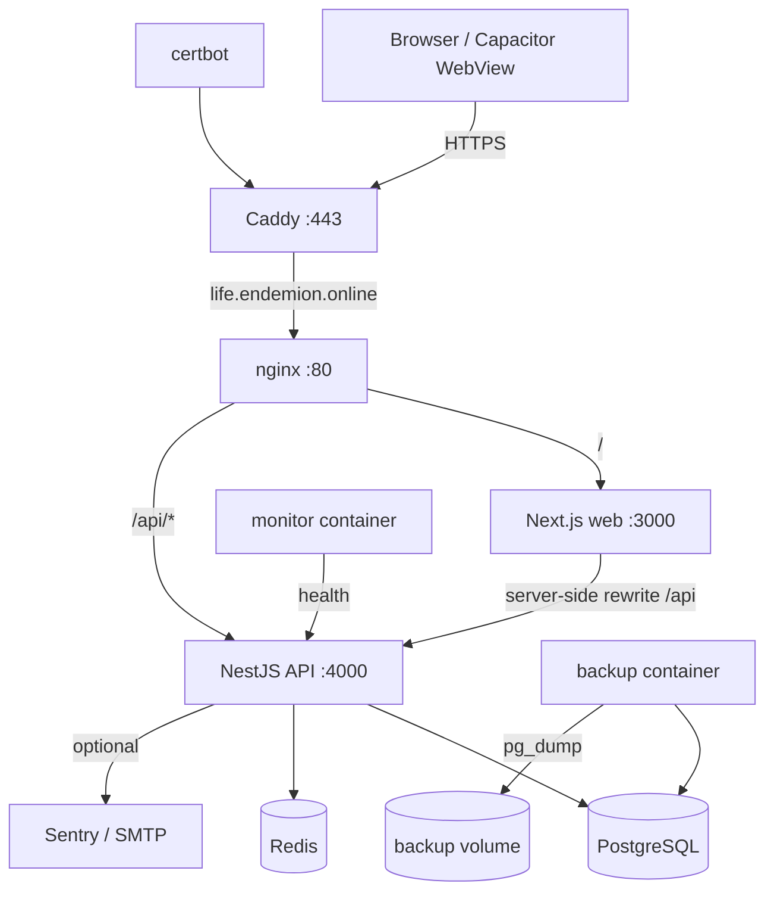
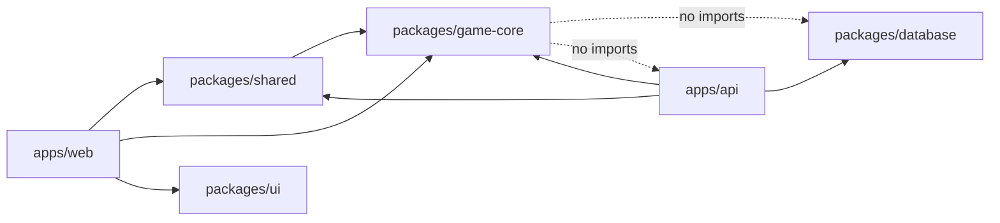
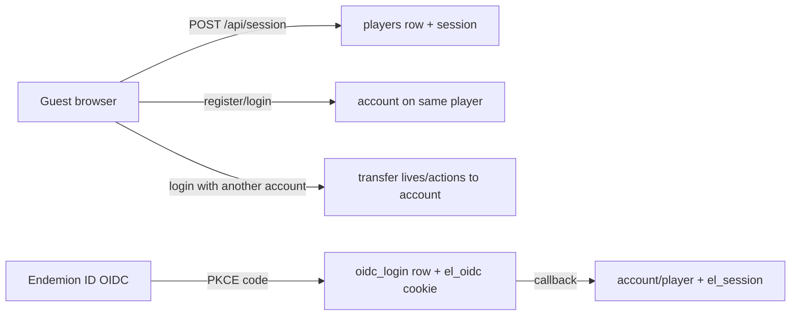
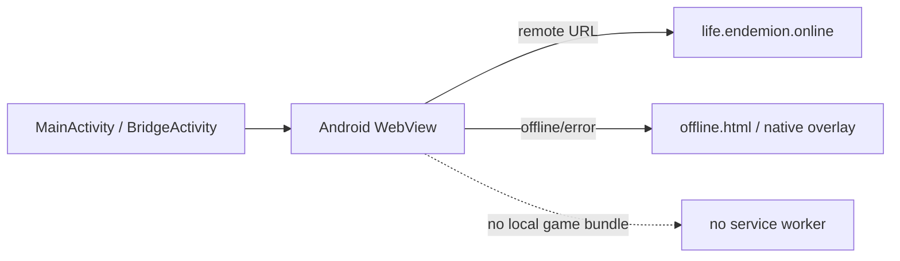

# Endemion Life — Architecture Map

**Scope:** deployed architecture at production `ca72b8b`, plus the uncommitted Stage 11.2 portal work separately marked.
**Method:** static inspection of `apps/`, `packages/`, `infrastructure/`, `.github/` and production container topology. No services were started or changed.

---

## 1. Current runtime topology



- The browser talks only to the first-party origin. Next.js rewrites `/api/:path*` to the API, and nginx also routes `/api/*` directly in production.
- Session cookie `el_session` is first-party, `HttpOnly`, `SameSite=Lax`, `Secure` in production. The same origin is what makes the Android remote-WebView cookie strategy viable.
- `web` and `api` are separate containers from the same monorepo. PostgreSQL and Redis are private.
- The Android app is a remote shell pointing at `https://life.endemion.online`; it does not bundle the Next.js app.

### Deployment units

| Unit | Technology | Responsibility |
|---|---|---|
| `apps/web` | Next.js 16 App Router, React 19 | UI, routing, locale, client play loop, Next rewrite |
| `apps/api` | NestJS 12 | HTTP contract, auth, ownership, transactions, persistence |
| `packages/game-core` | Pure TypeScript | Rules, simulation, content, save engine; no network/DB |
| `packages/shared` | TypeScript + zod | API schemas, view types, shared constants |
| `packages/database` | Prisma 7 client | Generated client and schema access |
| `packages/ui` | React primitives | Button, Panel and small shared UI |
| `infrastructure` | Docker Compose, nginx, backup, monitor | Runtime topology, TLS edge, backups, checks |
| `android/` | Gradle + Capacitor 8.6 generated project | Native WebView shell |

---

## 2. Monorepo dependency direction



Intended boundary: `game-core` has no database, network or framework dependency. This is true in practice for the engine and is a major strength. The web client imports `game-core` for the local prototype; the API imports it for authoritative actions.

`packages/shared` defines API contracts and view types. It does not own game rules. `packages/database` is intentionally thin: schema plus generated Prisma client.

---

## 3. Game-core module map

`packages/game-core/src` (83 source files, ~16.7k lines) is organized by domain:

| Area | Files/examples | Responsibility |
|---|---|---|
| Engine | `engine/game.ts`, `engine/save.ts`, `engine/import.ts`, `engine/actions` | `newGame`, `applyAction`, advance/choose/interact/trade/venture, save parse/migrate, restore, import |
| Character | `character/generator.ts`, `birth.ts`, `npcs.ts`, `npc-life.ts`, `social.ts`, `derived.ts` | Creation, family at birth, NPC generation and yearly life, relationships |
| RPG | `rpg/` | Stats, skills, XP/levels, talents, weaknesses, checks, progression |
| Narrative | `narrative/` | Event DSL, conditions, effects, selection, consequences, history |
| Family/dynasty | `family/kin.ts`, `legacy/succession.ts`, `legacy/laws.ts`, `legacy/lineage.ts` | Kin graph, marriage, death, heirs, inheritance laws, chronicle |
| Economy | `economy/` | Income, expenses, cycles, market goods, regional stock/strain |
| Adventure | `adventure/` | Places, steps, choices, rewards, per-life adventure state |
| World | `world/rules.ts`, `world/quests.ts`, `world/` | Per-world yearly rules, meters, factions, settlements, activity feed |
| Mastery | `mastery/` | End-of-year objectives and world mastery |
| Universe content | `universes/*.ts`, `universes/*.world.ts`, `registry.ts` | Six worlds, races, origins, events, tracks, factions, adventures |
| Live/insights helpers | `live/`, `insights/` types/helpers | Per-life participation and fact generation support |
| RNG/i18n/types | `rng.ts`, `i18n.ts`, `types.ts`, `stats.ts` | Deterministic RNG, RU/EN text, state contracts |

### Determinism model

- `GameState.seed` is the root seed; named streams derive independent sequences (`seed::birth`, adventure, market, etc.) via `Rng.fromSeed`.
- The client sends an **intent**, never a resulting state.
- The server loads the current state, calls `applyAction(state, action)`, and persists the returned state atomically.
- `state.version` increments on every accepted action. `expectedVersion` and a unique `(lifeId, actionId)` make requests idempotent and detect stale clients.
- Save schema is 8. Migration functions 1→8 are pure and additive.

---

## 4. API surface

All routes are under `/api`.

| Controller | Routes | Auth/authority |
|---|---|---|
| `session` | `GET /session`, `POST /session` | Public; POST creates guest player + session |
| `auth` | `me`, `register`, `login`, `logout`, `verify-email`, `resend-verification`, `forgot-password`, `reset-password`, `sessions`, `sessions/revoke`, `sessions/revoke-others` | Public where expected; session for session management |
| `auth` (OIDC) | `config`, `oidc/login`, `oidc/callback` | Public; PKCE + state + nonce |
| `catalog` | `GET /universes`, `GET /universes/:id` | Public, cached 300 s |
| `health` | `GET /health` | Public; DB/Redis status |
| `lives` | `POST /lives`, `POST /lives/import`, `GET /lives`, `GET /lives/:id`, `POST /lives/:id/actions`, `GET /lives/:id/history`, `GET /lives/:id/saves`, `POST /lives/:id/restore`, `POST /lives/:id/succession`, `GET /lives/:id/lineage` | Session + ownership for every `:id` route; create can mint a guest session |
| `social` | `GET /social`, `POST /social/requests`, `POST /social/requests/:id/accept`, `DELETE /social/ties/:id`, `POST /social/block`, `GET /social/players`, `GET /social/players/:id` | Session; pair membership checks |
| `live` | `GET /live`, `POST /live/:id/contribute`, `POST /live/:id/claim` | Session + own life |
| `live` ops | `POST /live/manage`, `POST /live/manage/:id`, `GET /live/manage/:id/log` | Shared `x-live-ops` token; 404 if unset/mismatched |
| `insights` | `GET /insights` | Shared `x-live-ops` token |
| `portal` (uncommitted) | `GET /portal/profile` | ES256 JWT from Endemion portal; read-only |

There is **no** WebSocket, SSE, socket.io or long-polling endpoint.

### Global request pipeline

1. Request logging (request ID, method, path without query, status, duration, IP).
2. Helmet security headers; HSTS disabled at API (edge sets it).
3. Cookie parser.
4. JSON body limit: 2 MB only for `/api/lives/import`, 16 KB otherwise.
5. CORS with explicit origins and credentials.
6. `RateLimitGuard` (120/min/IP via Redis; skips health; fail-open on Redis errors).
7. `RequestGuard` (mutations require JSON and, when `Origin` exists, an allowed origin).
8. Controller → service → Prisma.

---

## 5. Authoritative action flow

```mermaid
sequenceDiagram
  participant B as Browser
  participant W as Next.js
  participant A as NestJS
  participant DB as PostgreSQL
  B->>W: POST /api/lives/:id/actions {actionId, expectedVersion, action}
  W->>A: same-origin rewrite
  A->>A: session -> playerId; validate zod
  A->>DB: BEGIN; SELECT life WHERE id=? AND player_id=? FOR UPDATE
  A->>A: replay check (lifeId, actionId) and payload
  A->>A: version check; parseSave(state); applyAction(state, action)
  A->>DB: UPDATE life; INSERT history; INSERT snapshot; INSERT game_action
  A->>DB: COMMIT
  A-->>B: LifeView + entries
```

Properties:

- The client cannot submit stats, rewards or outcomes.
- A repeated `actionId` with the same canonical payload returns the existing result.
- A repeated `actionId` with a different payload returns `409 ACTION_ID_REUSED`.
- A stale `expectedVersion` returns `409 VERSION_CONFLICT`.
- Snapshots are kept to the last 50 versions.
- History is sequentially numbered and paged.

Known limitations: replay returns the **current** life row rather than the historical response; restore does not remove old `game_action` rows; live claims do not create a `game_action` and are not reconciled with restore.

---

## 6. Authentication and identity



- Session token: 32 random bytes, base64url; DB stores SHA-256 only; 365-day absolute cookie.
- Password: scrypt N=2^15, r=8, p=1; lockout after 5 failures for 15 minutes.
- OIDC: authorization code + PKCE S256, hashed state, nonce, one-time row, ID-token validation by `openid-client`; refresh token encrypted AES-256-GCM.
- Guest→account transfer moves `lives` and `game_actions`; it does **not** move `ties` or `live_parts` (cascade deletes them).
- No account deletion endpoint exists.

The uncommitted portal adds a read-only profile endpoint, verified ES256 JWT, fixed JWKS URL, `iss`/`aud`/`scope` checks, short token lifetime and per-subject rate limiting. It is not in production and not in the committed build.

---

## 7. Data ownership and schema

| Table | Owner | Key relation | Notes |
|---|---|---|---|
| `players` | API/auth | root identity | guest or account; optional `endemion_sub` |
| `accounts` | auth | 1:1 player | email, scrypt hash, verification, lockout |
| `sessions` | auth | N:1 player | opaque credential digest, refresh credential, expiry/revocation |
| `oidc_logins` | auth | transient | state hash, PKCE verifier, nonce, expiry |
| `auth_tokens` | auth | N:1 account | email verification / password reset |
| `lives` | lives | N:1 player | full game state JSON, version, schema, origin, generation |
| `life_snapshots` | lives | N:1 life | full state per version; max 50 per life |
| `history_entries` | lives | N:1 life | sequential narrative/action log |
| `game_actions` | lives | N:1 life | idempotency record and action audit |
| `ties` | social | player pair | friendship/block, unique pair |
| `live_windows` | live | global | scheduled/active/completed shared goal |
| `live_parts` | live | player + window | contributions and claim state; **no FK to life** |
| `live_log` | live | window | ops audit |
| `insights` | insights | none | aggregate anonymous facts, unique `(name, ref)` |

`Life.state` is a JSON document validated by `parseSave` on read. It is the single source of truth for a character's life; there is no normalized inventory, item or relationship table. This is appropriate for a deterministic single-player save, but it is not a shared-world data model.

Migrations are additive and timestamped. There are no down migrations; rollback is backup + previous image.

---

## 8. Web architecture

- App Router pages: `/`, `/worlds`, `/create/[universe]`, `/play/[id]`, `/account`, `/reset-password`, `/social`, `/insights`.
- All pages are request-rendered because the root layout reads the locale cookie. There is no static generation, `loading.tsx`, `error.tsx` or route-level Suspense.
- Interactive leaves are client components; the play screen owns the life state and calls the API.
- `GameStore` abstracts local and cloud storage. Cloud mode is API-only; local mode runs `game-core` in the browser.
- Locale is a cookie (`el_locale`) and a 704-line bilingual dictionary shipped to the client.
- No global state library; local `useState` and props.
- No service worker, offline cache or background sync.

The local mode is a deliberate prototype and import path. It becomes a **server-authority risk inside the Android shell** if the API is unavailable but the web app is reachable (see SECURITY_AUDIT.md).

---

## 9. Infrastructure and operations

- Docker Compose production: nginx, api, web, postgres, redis, migrate one-shot, certbot, backup, monitor.
- Images built from a multi-stage Dockerfile; Next standalone output; API and web run as non-root `node`.
- CI: lint/typecheck/unit/build, API integration with Postgres 18 + Redis 8, Playwright E2E, Docker build matrix, compose validation, migration drift check.
- Security workflow: `pnpm audit`, dependency review, gitleaks full history, shellcheck, actionlint.
- Deploy workflow: requires green CI/security, `origin/main`, protected `production` environment, manual approvals for migrations/infra, builds four images and uploads over a restricted SSH gateway.
- Backups: `pg_dump` custom format, checksum, retention, optional S3. Not encrypted at rest.
- Monitoring: health checks, uptime monitor, Sentry optional. No APM, tracing, metrics or alerting proven in this audit.

**Actual release process diverged:** production `ca72b8b` was deployed manually; `origin/main` is still `c7951d0`; the deploy workflow has not been exercised for that release. This is a process failure, not a workflow-design failure.

---

## 10. Android architecture



- Capacitor 8.6, `appId online.endemion.life`, `server.url` production, `androidScheme https`, allow-list for life and auth hosts.
- Native `MainActivity` adds a startup overlay, 15 s timeout, retry, and WebView back handling.
- `apps/android/www` contains only `index.html` and `offline.html`; it is not a built web bundle.
- No Capacitor packages are declared in `package.json` or the lockfile; the generated Gradle project points at an orphan `node_modules/.pnpm` path.
- No signing keystore, no AAB release artifact in the repository, no push, no deep links, no account deletion.

---

## 11. Architectural risks and boundaries

| Risk | Evidence | Consequence |
|---|---|---|
| Web imports full game engine for local mode | `apps/web/src/lib/store/local.ts` imports `game-core`; `store/index.ts` statically imports `local.ts` | Cloud-only users download rules/content; bundle and memory cost |
| JSON life state is treated as the world | `Life.state`, no normalized world entities | Cannot share characters, items, property or trades without a new authoritative model |
| Per-life world simulation | `worldTick` runs inside `applyAction` for one life | Two players in the same "world" never see each other's actions |
| Shared live windows are outside the action transaction | `live_parts` updated separately from `life.state` | Claim/restore inconsistency and economy duplication |
| Portal is uncommitted and unwired | `apps/api/src/portal/`, no compose env | Cannot be deployed or tested through CI as-is |
| Single process assumptions | One API container, in-memory auth fallback, no queue | Background sweeps and shared simulation will not scale horizontally without redesign |
| No event bus/outbox | Insights written after commit, errors swallowed | Analytics can drift; shared-world events have no delivery mechanism |
| Origin release behind production | `origin/main = c7951d0`, prod `ca72b8b` | Disaster recovery cannot rebuild production from GitHub |

---

## 12. What must be preserved

1. `applyAction` purity and the intent-only client contract.
2. Named deterministic RNG streams and save versioning.
3. `expectedVersion` + `actionId` idempotency and row locking.
4. Ownership checks through session-derived `playerId`.
5. First-party cookie + same-origin API proxy, which is also the best Android session strategy.
6. The six-universe content/rule separation and bilingual content model.
7. The existing CI quality gate, even though the current release bypassed its deploy path.

The target evolution should add authoritative shared entities and a simulation boundary **around** this core, not replace it.
