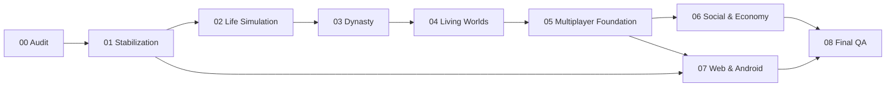

# Development Roadmap — Endemion Life

**Basis:** STAGE 00 audit findings, 2026-11-13.  
**Constraint:** preserve the existing game; evolve incrementally. No durations are given because team size/capacity is unknown. Complexity is relative, not a schedule.

---

## Guiding principles

1. **Stabilize before expanding.** No shared-world feature on top of known duplication/data-loss bugs.
2. **Solo remains playable** throughout the transition.
3. **Server authority is non-negotiable** for canonical saves, economy, and shared state.
4. **One game engine.** `game-core` stays pure; new mechanics are added there or in server modules, not in a parallel simulator.
5. **No big-bang rewrite** and no microservices before measurement.
6. **Every stage has a release gate.** A stage is not done because features exist; it is done when acceptance tests pass.

---

## STAGE 00 — Complete Project Audit

**Status:** COMPLETE (this audit).  
**Objective:** establish a reliable, evidence-based baseline and a sequenced plan.

**Delivered:** 14 documents in `docs/audit/`, including architecture, gameplay status, technical debt, security, performance, save, multiplayer gap, Android readiness, target architecture, roadmap, acceptance criteria, and final report.

**Exit gate:** audit reviewed and approved; no production changes made.

---

## STAGE 01 — Core Stabilization

**Objective:** make the existing single-player product safe, reproducible, and release-clean before adding systems.

**Why first:** production is 3 commits ahead of `origin/main`; the portal work is uncommitted; a live-window restore exploit is deployed; one game-core test fails; Android cannot be rebuilt from a clean checkout; desktop play has a visible layout regression.

**Required changes**
- **Release provenance**
  - Decide the canonical branch state; commit/push the audited tree (including or explicitly excluding portal work) with a tagged release.
  - Ensure `origin/main` can reproduce production `ca72b8b` + docs commit; stop manual-only deploys.
  - Record deployed SHA, migration state, and rollback target in the release checklist.
- **Data integrity**
  - Fix live claim → restore → claim duplication (S-12/L-1): make claims irreversible by restore, or reverse live progress/part counts and reward ledger atomically.
  - Fix guest→account transfer losing `LivePart` rows (S-03); add a Life FK or move rows transactionally.
  - Fix lineage consequence provenance (`ctx.source` cleared before `emit("consequence")`; use `item.src`, not `item.id`).
  - Fix replay response to return the original action result (or explicitly document current-state semantics).
  - Add regression tests for restore/live claims, guest merge, provenance.
- **Auth/security**
  - Fix OIDC offline grace to hard-revoke after expiry; do not advance `refreshedAt` before a successful refresh (S-01).
  - Fix social block ownership overwrite (S-04); fix OIDC link race (S-05).
  - Decide rate-limit fail-open policy for expensive routes (S-06); add tests.
  - Enforce alive-life cap transactionally (S-07).
  - Tighten import bounds (age/name/version/history) and return 400, not 500 (S-08).
  - Add CSP; plan session rotation/`__Host-`; separate ops tokens (S-13/S-14/S-15).
- **Portal decision**
  - Either commit portal code + tests + compose/env wiring + staging verification, or archive it off the main branch. Do not leave it half-integrated (S-02).
- **Frontend**
  - Fix duplicate/misplaced Dossier at `lg` (`play-screen.tsx:337,433-441`): render exactly one dossier per breakpoint.
  - Fix homepage 58px horizontal overflow from decorative glows; add `overflow-x: clip`.
  - Disable local prototype new-life creation in the Android shell when API is unavailable (F-04/S-11); show blocking retry.
  - Add `loading.tsx`/`error.tsx` and fetch timeouts; surface cloud-list errors.
- **Android**
  - Declare Capacitor dependencies in a package + lockfile; regenerate native project; add `cap sync`/build scripts; CI debug build (F-02).
  - Add safe-area support, 44px targets, and test on API 36 (F-03).
  - Add signing/keystore process and a dry-run AAB; add account deletion or compliant URL (F-05).
- **Testing**
  - Make the 609-test suite green; mark/repair the two 5s timeouts.
  - Add save-compatibility fixtures for schema 5–8 and a restore/shared-state regression suite.
  - Run API e2e and web Playwright in CI (not only locally).
- **Docs**
  - Replace `PROJECT_STATUS.md` with a current status or mark it superseded.
  - Reconcile `README.md`, `docs/DEPLOYMENT.md`, `docs/HTTPS_SETUP.md`, and the Android docs with reality.

**Dependencies:** none; can start immediately.  
**Relevant files:** `apps/api/src/lives/lives.service.ts`, `apps/api/src/live/live.service.ts`, `apps/api/src/auth/endemion-id.service.ts`, `apps/api/src/social/social.service.ts`, `packages/game-core/src/legacy/lineage.ts`, `apps/web/src/components/play/play-screen.tsx`, `apps/web/src/app/page.tsx`, `capacitor.config.ts`, `android/`, `.github/workflows/`, `docs/`.

**Risks:** scope creep into gameplay; touching save schema (do not); portal decision delay; Android signing secrets.

**Acceptance criteria**
- Production SHA reproducible from `origin/main`; CI green.
- No known duplication/data-loss path in restore, live claims, or guest merge.
- OIDC revocation test proves a revoked session cannot revive after grace.
- Desktop play shows one dossier; mobile homepage has no horizontal overflow.
- Android debug build works from a clean clone; release AAB dry-run succeeds.
- 100% of existing unit tests pass; new regression tests cover each fixed defect.
- No new gameplay features shipped in this stage.

**Complexity:** High (release/security/data work, not feature volume).

---

## STAGE 02 — Advanced Life Simulation

**Objective:** make the solo life sim deep enough to sustain long play before adding shared systems.

**Required changes**
- Health/illness/injury model with causes and recovery; expose cause of death.
- Education/career progression with choices and prerequisites; wages, unemployment, retirement.
- Property/household/business ownership (solo first), expenses and maintenance.
- Travel between settlements; location affects events/economy.
- Deeper character creation agency (point-buy or background packages) without invalidating existing saves.
- Balance pass: aging, death, wealth, skill growth; anti-grind.

**Dependencies:** STAGE 01 stable; save schema additive (no destructive changes).  
**Relevant files:** `packages/game-core/src/character/`, `life/`, `economy/`, `engine/game.ts`, `packages/shared/src/views.ts`, web dossier/play panels.

**Risks:** balance regressions; save size growth; event pacing.

**Acceptance criteria**
- A 60–80 year life has meaningful choices in health, education, career, and property.
- Health/death causes are visible and testable.
- Existing schema 8 saves migrate/play without data loss.
- New mechanics have unit tests and a long-run soak test.

**Complexity:** High.

---

## STAGE 03 — Dynasty & Legacy

**Objective:** complete the generational loop and make legacy the primary retention mechanic.

**Required changes**
- Make relics reachable in normal play; define acquisition, loss, and inheritance.
- Persist world/social state across succession (stop resetting `world.tick` and social memory).
- Family property/heirlooms, guardianship, regency, inheritance disputes.
- Family chronicle/history UI improvements; accomplishments across generations.
- Heir agency: player choice, traits, education, relationship effects.
- Balance inheritance laws per world; test long dynasties.

**Dependencies:** STAGE 02 life systems stable.  
**Relevant files:** `packages/game-core/src/legacy/`, `family/`, `world/`, `engine/game.ts`, `packages/shared/src/views.ts`, lineage UI.

**Risks:** save compatibility; economy inflation across generations; succession edge cases.

**Acceptance criteria**
- A dynasty can play 5+ generations with persistent world/social state.
- Relics can be obtained, inherited, and lost through normal play.
- Inheritance laws produce distinct, tested outcomes.
- No duplication or lost property across succession/restore.

**Complexity:** High.

---

## STAGE 04 — Living Worlds

**Objective:** build the server-owned world read model and tick, still mostly single-player-facing.

**Required changes**
- `World`, `WorldSeason`, `Settlement`, `Faction`, `WorldEvent` tables and projections.
- Deterministic season tick (seed + command log), replayable; worker process.
- Shared world feed, settlement/faction pages, prices/resources visible to all.
- Map existing per-life world state to the shared projection at read time; keep solo saves working.
- World event calendar and admin controls with audit.
- Observability: tick duration, projection lag, invariant checks.

**Dependencies:** STAGE 01; STAGE 03 persistence decisions.  
**Relevant files:** new `apps/api/src/world/`, `apps/worker/`, `packages/database/prisma/schema.prisma`, `packages/game-core/src/world/`, web world pages.

**Risks:** divergent per-life vs shared state; tick replay bugs; migration complexity.

**Acceptance criteria**
- Two players see the same settlement/faction state.
- A season tick is deterministic and replayable from its log.
- Solo saves still load and play; no shared write is required to advance a solo life.
- Tick failure rolls back cleanly and alerts.

**Complexity:** Very High.

---

## STAGE 05 — Multiplayer Foundation

**Objective:** let accounts share the world safely: presence, realtime notifications, shared actions.

**Required changes**
- Require an account for shared-world participation; guest remains solo-only.
- WebSocket/SSE gateway, Redis presence, heartbeats, reconnect, notifications.
- Shared world commands with idempotency, expected version, rate limits, audit.
- Account deletion/export and moderation basics.
- Feature flags/cohort rollout; anti-cheat review; load tests.
- Shared-world conflict UX (stale world, retry, refresh).

**Dependencies:** STAGE 04 read model; STAGE 01 auth hardening.  
**Relevant files:** `apps/api/src/world/`, `social/`, `apps/web/src/components/`, new gateway, Redis, shared contracts.

**Risks:** concurrency, realtime scaling, abuse, account adoption (production currently 0 accounts).

**Acceptance criteria**
- Two accounts can see each other online and receive a world notification.
- Concurrent shared actions cannot duplicate rewards or corrupt projections.
- Reconnect after network loss restores presence/state.
- Guests cannot access shared mutations.
- Load test at target concurrency passes with documented limits.

**Complexity:** Very High.

---

## STAGE 06 — Social & Economic Systems

**Objective:** deliver player families/organizations and a player-driven economy.

**Required changes**
- Families/households with consent, roles, shared property, cross-account inheritance.
- Guilds/orders/associations with membership, roles, projects, reputation.
- Append-only ledger for currency/resources; shared market with supply/demand; sinks/faucets.
- Player-to-player trade with escrow, offers, expiry, cancellation, audit.
- Businesses/contracts/wages/rent (start narrow).
- Chat/notifications with moderation and abuse controls.
- Anomaly detection and admin correction tools.

**Dependencies:** STAGE 05 identity/presence/world; live duplication fix.  
**Relevant files:** new `apps/api/src/economy/`, `social/`, database migrations, web social/economy UI.

**Risks:** fraud/duplication, inflation, moderation load, privacy, family consent disputes.

**Acceptance criteria**
- Ledger reconciles every balance; no negative/duplicated currency in property-based tests.
- A trade either completes atomically or leaves both sides unchanged.
- A family can share property and pass it to an heir across accounts with consent.
- Guild projects have auditable contributions/rewards.
- Abuse/report/block flows work.

**Complexity:** Very High.

---

## STAGE 07 — Web & Android

**Objective:** ship a stable web + Android release with shared account/progress.

**Required changes**
- Web: performance/bundle splitting, accessibility, responsive fixes, error/loading states.
- Android: Capacitor dependency/build/signing, safe areas, offline/network UX, push (optional), Play compliance, account deletion.
- Shared release pipeline for web/API/Android; versioning and rollback.
- Device matrix QA, store listing, privacy policy, data-safety form.
- Monitoring/crash reporting for mobile.

**Dependencies:** STAGE 05/06 APIs stable; STAGE 01 Android groundwork.  
**Relevant files:** `apps/web/`, `apps/android/`, `android/`, CI workflows, store assets.

**Risks:** Play rejection (thin wrapper), WebView performance, signing/keys, review delays.

**Acceptance criteria**
- Signed AAB accepted/uploadable; internal testing track passes core journey.
- Web and Android share account/save; session persists.
- No horizontal overflow/safe-area clipping on target devices.
- Core flows pass on low-end Android and tablet.
- Rollback and crash monitoring documented.

**Complexity:** High.

---

## STAGE 08 — Final QA & Release

**Objective:** prove the multiplayer living world is stable, secure, and operable.

**Required changes**
- Full regression: unit, API e2e, web e2e, Android, save compatibility (1–8), restore, succession, shared world.
- Load/soak/chaos: DB failover, Redis outage, worker crash, tick replay, backup restore.
- Security review: authz matrix, rate limits, import/anti-cheat, secrets, dependency audit.
- Disaster recovery drill and runbooks; on-call/monitoring.
- Performance budgets and capacity plan.
- Release checklist, staged rollout, rollback.

**Dependencies:** all prior stages.  
**Risks:** late discovery of cross-system bugs; operational gaps.

**Acceptance criteria**
- All acceptance criteria from Stages 01–07 pass in a production-like environment.
- Restore from backup into a clean environment succeeds within the documented RTO.
- No P0/P1 security findings open.
- Load test meets the agreed concurrency/latency budget.
- Rollback rehearsed; release signed off by engineering and product.

**Complexity:** Very High.

---

## Dependency graph

**Parallelizable:** STAGE 01 Android groundwork and web fixes can run alongside security/data fixes; STAGE 07 Android engineering can start after STAGE 05 contracts stabilize, but release waits for STAGE 06.

---

## What not to do

- Do not start shared-world tables before the live/restore duplication and guest-merge bugs are fixed.
- Do not build player families before presence, identity, and moderation exist.
- Do not add a player economy before an append-only ledger and anti-dupe tests exist.
- Do not migrate save schema 8 in a big-bang deploy.
- Do not split into microservices to look modern; the current monolith is not the bottleneck.
- Do not ship Android as a thin wrapper without fixing reproducibility, safe areas, local-mode fallback, and Play compliance.
