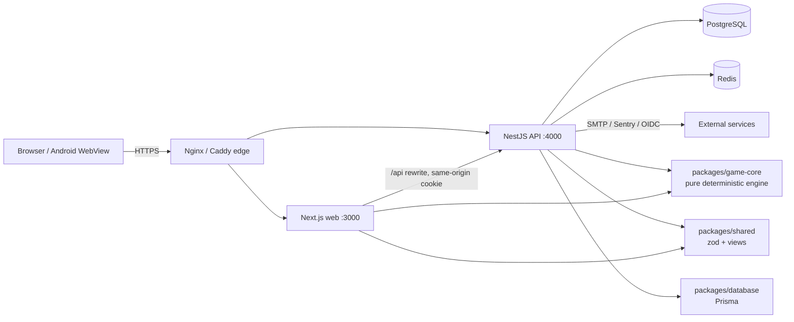
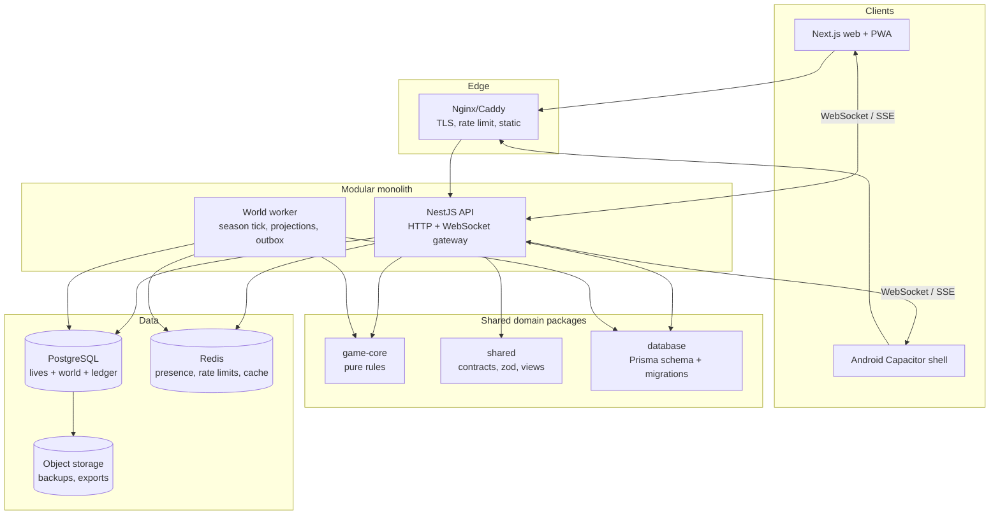

# Target Architecture — Endemion Life

**Status:** proposal for evolution, not implemented in STAGE 00.  
**Principle:** preserve the existing deterministic engine and server-authoritative solo pipeline; add a shared-world layer around it incrementally.

---

## 1. Design goals

- Keep six-world life simulation, dynasty, story, and save compatibility.
- Add a persistent, server-authoritative shared world.
- Support Web and Android from one API and one account.
- Make every shared mutation auditable, idempotent, and safe under concurrency.
- Avoid microservices, a second game engine, or a big-bang rewrite.
- Allow solo play to continue while multiplayer is introduced behind flags.

### Non-goals for the first multiplayer release

- Real-time combat or twitch gameplay.
- A native mobile rewrite.
- A distributed multi-region shard system.
- A full player-run nation-state simulation.
- Microservices without measured need.

---

## 2. Current architecture



**Current characteristics**

- Modular monolith: one API process, one web process, one PostgreSQL, one Redis.
- `game-core` is pure and synchronous; it has no DB/network imports.
- Client sends intents (`advance`, `choose`, `interact`, `trade`, `venture`, `setMode`, succession/restore); API applies them.
- Life state is one JSON document per life; actions are serialized with `SELECT … FOR UPDATE` and `expectedVersion`.
- Shared tables are limited to players/sessions/accounts, ties, live windows/parts, insights.
- No worker, queue, event bus, WebSocket, or shared world tick.
- Production: 1 vCPU / 2GB VPS, 48MB DB, 18 players / 43 lives.

**What to keep**

- `game-core` purity/determinism and event DSL.
- Intent-only API and version/idempotency model.
- PostgreSQL as the source of truth; Redis for ephemeral coordination.
- Next.js same-origin proxy and first-party cookie.
- Additive migrations and save schema 8 until a tested version 9 exists.

---

## 3. Proposed architecture



**One deployable API + one worker**, not microservices. The worker can initially be the same image with a different command, then split into a separate container when load requires it.

### 3.1 Module boundaries

| Module | Owns | Must not own |
|---|---|---|
| `game-core` | Pure rules: actions, events, dynasty, economy, world rules | DB, HTTP, sessions, clock, randomness sources |
| `shared` | Zod contracts, API views, error codes, constants | Business rules or persistence |
| `database` | Prisma schema, migrations, generated client | Domain decisions |
| `api/lives` | Solo life lifecycle, snapshots, succession, import | Shared world mutations |
| `api/world` (new) | World/season/settlement/faction projections, world commands | Private life state |
| `api/social` | Ties, presence, chat, guilds/families | Economy ledger internals |
| `api/economy` (new) | Ledger, market, trade escrow, businesses | Character stats/rules |
| `api/identity` | Sessions, accounts, OIDC, deletion/export | Gameplay |
| `worker/world` (new) | Season tick, NPC population, event calendar, outbox projections | Client-facing request handling |
| `worker/economy` (new) | Periodic sinks/faucets, market rebalance, anomaly checks | Direct player actions |

### 3.2 Data ownership

| Data | Owner | Storage | Notes |
|---|---|---|---|
| Account/session | identity | `players`, `accounts`, `sessions`, `oidc_logins` | Token hash only; cascade rules tested |
| Solo life | lives | `lives.state` JSON | Keep schema 8; per-life source of truth |
| Life history/snapshots | lives | `history_entries`, `life_snapshots` | 50-snapshot cap; restore audit |
| Shared world | world | `worlds`, `world_seasons`, `settlements`, `factions`, `world_events` | New normalized tables |
| Presence | social | Redis + `player_presence` (optional) | TTL heartbeat, not authoritative history |
| Family/guild | social | `families`, `family_members`, `organizations`, `memberships` | Consent + roles |
| Ledger | economy | `ledger_entries` (append-only) | Source of truth for balances |
| Trade | economy | `trade_offers`, `trade_escrow` | Transactional swap, idempotency |
| Live windows | live | existing `live_windows`/`live_parts` | Fix FK/merge bugs first |
| Analytics | insights | existing `insights` | Anonymous aggregates |

**Rule:** a table has exactly one writing module. Cross-module changes go through an application service/transaction, never by one module writing another's tables directly.

### 3.3 Server authority boundaries

**Server-authoritative (never trust client):**
- Stats, resources, health, age, death, events, choices, rewards.
- Succession eligibility, heir creation, inheritance.
- Market prices, stock, trades, currency balances.
- World season/tick, settlements, factions, world events.
- Presence status, family/guild membership, permissions.
- Live-window contribution/reward eligibility.

**Client-authoritative (UI only):**
- Selected tab, filters, locale, local guide dismissal.
- Optimistic display state that is reconciled from server responses.
- Local prototype lives **only** on web, explicitly marked non-canonical; disabled in Android.

**Anti-cheat principles:**
- No client-supplied rewards/balances/levels in mutations.
- Server generates salts/seeds for canonical lives; client seeds only for explicitly local/private games.
- Import is a one-way, marked `local-import` path with strict bounds and provenance; never eligible for shared rankings/economy without review.
- Every shared command carries `actionId`/idempotency key and expected version.
- Append-only ledger + reconciliation job; anomaly alerts for negative balances, minted currency spikes, duplicate rewards.

### 3.4 API responsibilities

**Keep HTTP for turn-based life actions.** A life turn is request/response; WebSocket is not needed for correctness.

**Add WebSocket (or SSE first) for:**
- presence heartbeat/online roster;
- notifications (event available, family request, trade offer, world event);
- world feed/live window updates;
- chat (later, with moderation).

**API surface proposal**

| Area | Endpoints (indicative) | Authority |
|---|---|---|
| Identity | existing auth/session/OIDC; add `DELETE /api/account`, export | account owner |
| Solo life | existing `/api/lives/*` | player |
| World read | `GET /api/world`, `/world/settlements`, `/world/factions`, `/world/feed` | public/authenticated |
| World action | `POST /api/world/actions` (idempotent) | authenticated, rate-limited |
| Presence | `GET /api/presence`, WS `presence` | authenticated |
| Family | `POST /api/families`, invites, roles, leave | consent-based |
| Guild | `POST /api/organizations`, memberships, projects | roles |
| Trade | `POST /api/trades`, accept/cancel, escrow | both parties |
| Ledger | `GET /api/economy/balance`, history | owner |
| Live | existing `/api/live/*`; ops moved to separate admin surface | ops token/scoped admin |
| Portal | `GET /api/portal/profile` | portal JWT |

**Versioning:** additive JSON fields and new endpoints; do not break existing clients. Deprecate with a sunset header and telemetry.

### 3.5 Synchronization approach

- **Life turns:** HTTP intent + optimistic version + idempotency key. No client prediction for canonical state; show pending spinner and reconcile response.
- **World:** server tick every season (or a fixed interval), deterministic given season seed and command log. The tick writes a `world_events` row and updates projections in one transaction; replayable by season ID.
- **Presence:** Redis TTL keys + WebSocket heartbeat; database only stores last-seen for offline social lists.
- **Notifications:** outbox table → worker → WebSocket/push; at-least-once with dedupe IDs.
- **Offline:** no queued authoritative turns. Cache read-only views; on reconnect, refetch and show conflict/refresh. Android must not create local canonical lives.
- **Conflict:** `409 VERSION_CONFLICT` for life; `409 STALE_WORLD` for world commands with a refreshed projection. Never last-write-wins on shared state.

### 3.6 Migration strategy

1. **Freeze schema 8 semantics**; add new tables/columns only, no destructive changes.
2. **Dual-write projections**: when a solo life acts, emit domain facts (optional outbox) for analytics/world; do not yet mutate shared state.
3. **Read-only world**: build world/season/settlement projections from a seed; expose read APIs and a public feed. No player writes.
4. **Shadow mode**: run the world tick and compare projections against expected invariants; no player impact.
5. **Feature-flagged shared actions** for internal accounts; gradual rollout by cohort.
6. **Save schema 9** only when a field must move from JSON to normalized state; write a migration, fixture, rollback plan, and dual-read period. Never rewrite all lives in one deploy.
7. **Retire solo-only fields** only after all clients and saves are migrated.

**Compatibility:** keep parsing schema 1–8 forever for old lives; new shared fields must be optional/normalized at action boundaries, as today.

### 3.7 Security considerations

- Account-gate shared features; guests can play solo but cannot trade/join organizations.
- Enforce authorization at the query level (`playerId` from session, never body).
- Separate ops/admin tokens by scope; rotate; audit every admin action.
- Encrypt backups; restrict restore access; test restore quarterly.
- CSP, HSTS, secure cookies, `__Host-` prefix, shorter session lifetime/rotation.
- Rate-limit imports, world actions, trade, chat, portal separately; fail closed for expensive routes when Redis is down.
- Moderate chat/guild names; block lists; report/abuse workflow.
- Privacy: account deletion/export, data-minimized insights, retention policy.
- Anti-dupe: append-only ledger, unique idempotency keys, transactional escrow, reconciliation.

### 3.8 Scaling strategy

**Phase 1 (now–early multiplayer):** vertical scale the 1 vCPU/2GB VPS to 2–4 vCPU/4–8GB; separate worker container; connection pooling; Redis; optimize snapshot writes. This is sufficient for thousands of solo lives.

**Phase 2:** read replicas for world/feed; partition `game_actions`/`history_entries` by time or life; archive snapshots to object storage; cache world projections.

**Phase 3:** shard by world/region only when a single PostgreSQL primary is the measured bottleneck. Keep one logical world per shard; cross-shard trade is out of scope.

**Do not:** introduce Kafka/event sourcing/microservices before measurement. The current monolith is small; premature distribution would add failure modes the team cannot yet operate.

---

## 4. Module dependency rules

```
web ──► shared ──► game-core
api ──► shared ──► game-core
api ──► database
worker ──► game-core, database, shared
shared ──► game-core (types only)
game-core ──► nothing (pure)
```

- No `game-core` import of Prisma/HTTP/Redis.
- No web import of database/API internals.
- New world/economy modules expose application services, not raw Prisma models, to controllers.
- Domain events are plain objects; transport adapters live in API/worker.

---

## 5. Proposed folder evolution (incremental)

```
apps/api/src/
  lives/            # existing solo lifecycle
  world/            # new: read models, commands, season service
  economy/          # new: ledger, market, trade
  social/           # extend: presence, families, organizations
  identity/         # rename/split auth+session later, no big-bang
  live/             # existing; fix + isolate ops
  insights/         # existing
apps/worker/        # new process, same image, tick/outbox jobs
packages/game-core/ # unchanged purity; add shared-world rules only if pure
packages/database/  # additive migrations
packages/shared/    # contracts/views for new APIs
```

Do not physically move existing modules just to match this layout. Add new modules alongside; rename only when tests and imports are stable.

---

## 6. Decision records to create before implementation

1. **World model:** single global world vs per-world shards; season length; reset policy.
2. **Canonical time:** real-time seasons vs tick-on-demand; offline progression.
3. **Account requirement:** which features require an account.
4. **Family model:** one household vs dynasty; consent and inheritance across accounts.
5. **Ledger:** currency/resource scope; mint/burn authority; caps.
6. **Realtime:** WebSocket vs SSE for v1; hosting and reconnect.
7. **Android:** Capacitor remote shell vs TWA; Play risk acceptance.
8. **Save v9:** what moves out of JSON and when.

Each decision needs an ADR, a rollback plan, and a test strategy before code.

---

## 7. Success criteria for the architecture

- Solo play remains fully functional with schema 8 saves.
- A world season can be replayed deterministically from its seed + command log.
- Every currency/resource mutation appears in the ledger and reconciles.
- Two players can see the same settlement state and one player's action can affect it without corrupting the other's life.
- Presence and notifications reconnect cleanly after network loss.
- Android and web share the same account, character, and save.
- A restore cannot duplicate a shared reward.
- Backup restore into a clean environment is tested and documented.
- No shared table is writable by a client-supplied player ID.
